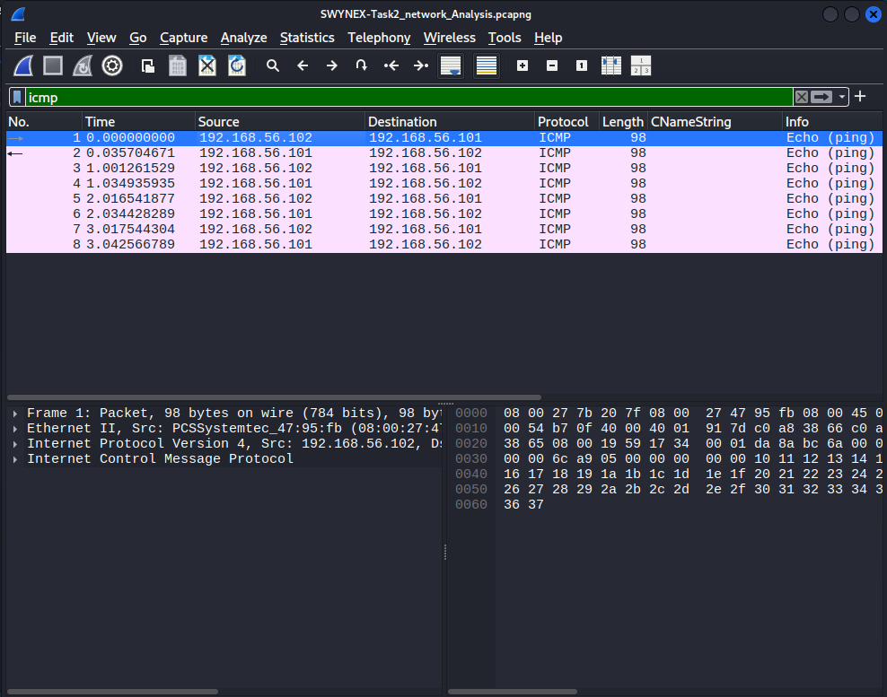
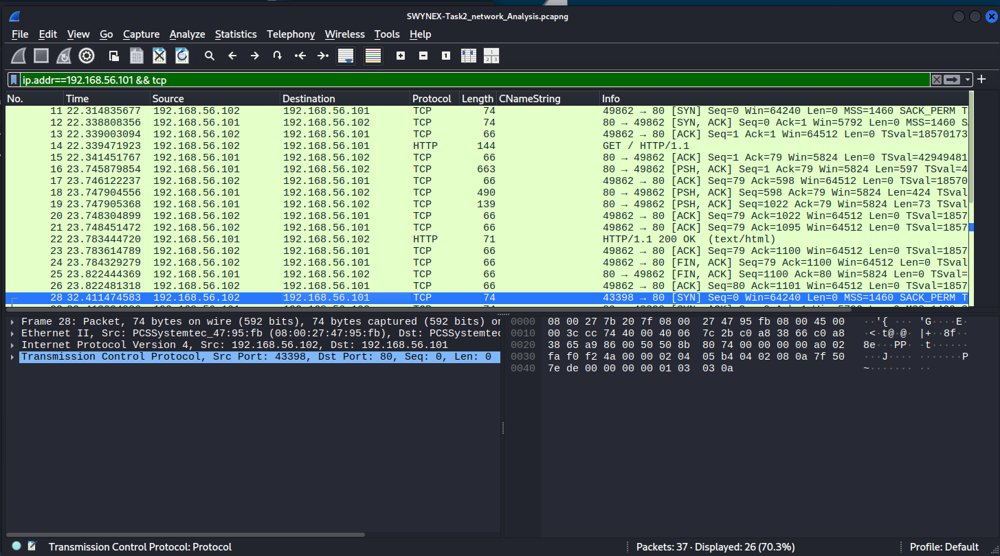
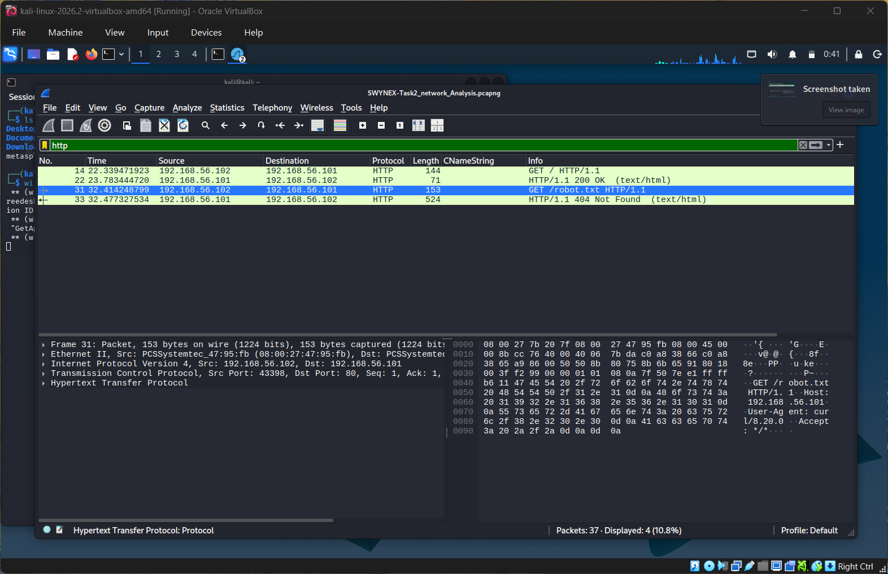
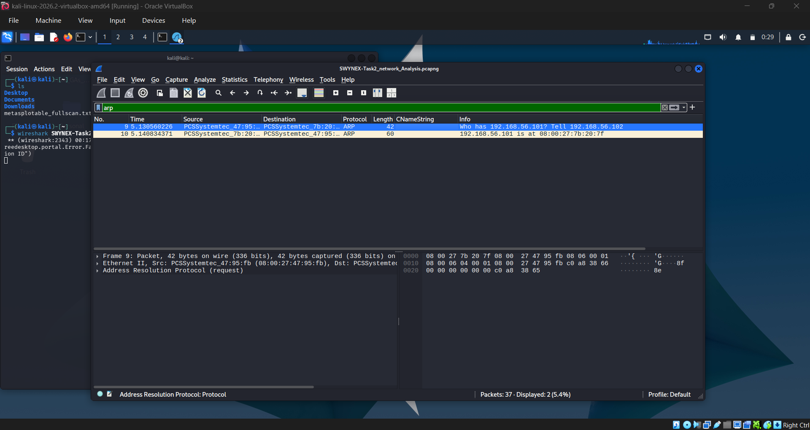

# SWYNEX Task 2 — Network Security Analysis

**Internship Track:** Cybersecurity Internship  
**Task:** Task 2 — Network Security Analysis  
**Analyst:** Junior Cybersecurity Analyst  
**Environment:** Isolated VirtualBox Host-Only Lab  
**Tool:** Wireshark  

---

## 1. Executive Summary

This report documents the defensive network security analysis conducted for **Task 2: Network Security Analysis** as part of the **SWYNEX Technologies Cybersecurity Internship**. The objective of this exercise was to capture, inspect, and evaluate network traffic generated in a strictly controlled, authorized laboratory environment using the defensive packet analysis tool **Wireshark**.

Network traffic was recorded between an analyst workstation running Kali Linux and an isolated target host running Metasploitable 2 within a VirtualBox Host-Only network. The analysis focused on fundamental network protocols, including **ICMP**, **TCP**, **ARP**, and Wireshark's **Protocol Hierarchy** statistics. 

All observed traffic resulted from controlled, legitimate administrative testing actions. This report distinguishes empirical observations from defensive security considerations, avoids unsubstantiated threat claims, and outlines concrete recommendations for network hardening, visibility, and perimeter defense.

---

## 2. Objective

The primary objectives of Task 2 were:
- Establish a baseline packet capture of controlled network traffic in an isolated virtualized lab environment.
- Inspect and dissect Layer 2, Layer 3, and Layer 4 protocol behaviors using Wireshark.
- Analyze connection mechanics, including address resolution (ARP), echo testing (ICMP), and transmission control handshakes (TCP).
- Differentiate between normal baseline communication patterns and potential defensive risks associated with unsegmented or unhardened environments.
- Formulate defensive hardening and monitoring recommendations based strictly on verified network observations.

---

## 3. Scope and Authorization

All testing, packet capturing, and network inspection activities were conducted under explicit authorization within a private, fully isolated virtual laboratory. 

- **Authorization:** Authorized solely for educational and training purposes under the SWYNEX Technologies Internship program.
- **Boundaries:** The testing scope was strictly limited to the private VirtualBox Host-Only subnet `192.168.56.0/24`.
- **Target Status:** The target machine is an intentionally vulnerable educational virtual machine (Metasploitable 2) hosted locally.
- **Non-Interference:** No external networks, production infrastructure, internet-facing systems, or third-party resources were accessed, targeted, or intercepted at any point during this assessment.

---

## 4. Lab Environment

The analysis environment consisted of two virtual machines interconnected via an isolated VirtualBox Host-Only network adapter, ensuring zero routability to external production networks.

| Component | Details |
|---|---|
| **Analyst Operating System** | Kali Linux |
| **Analyst IP Address** | `192.168.56.102` |
| **Analyst Interface** | `eth1` |
| **Lab Target Operating System** | Metasploitable 2 (Linux 2.6.x) |
| **Target IP Address** | `192.168.56.101` |
| **Target Interface** | `eth0` |
| **Network Configuration** | VirtualBox Host-Only Network |
| **Subnet / CIDR** | `192.168.56.0/24` |
| **Primary Analysis Tool** | Wireshark Packet Analyzer |

---

## 5. Methodology

The network analysis workflow followed an established defensive inspection methodology:

```
+--------------------------------------------------------------------+
| 1. Interface Identification & Verification                         |
|    - Verified IP assignment and interface binding on eth1          |
+--------------------------------------------------------------------+
                                  |
                                  v
+--------------------------------------------------------------------+
| 2. Traffic Capture Initiation                                      |
|    - Started promiscuous capture on eth1 via Wireshark             |
+--------------------------------------------------------------------+
                                  |
                                  v
+--------------------------------------------------------------------+
| 3. Controlled Traffic Generation                                   |
|    - ICMP echo requests: ping -c 4 192.168.56.101                  |
|    - HTTP / TCP connection attempts: curl http://192.168.56.101/   |
+--------------------------------------------------------------------+
                                  |
                                  v
+--------------------------------------------------------------------+
| 4. Capture Termination & Preservation                              |
|    - Stopped capture stream and preserved session                  |
+--------------------------------------------------------------------+
                                  |
                                  v
+--------------------------------------------------------------------+
| 5. Wireshark Filter Application & Protocol Dissection              |
|    - Applied display filters (arp, icmp, tcp, http)                |
|    - Inspected header fields, sequence numbers, and flags          |
+--------------------------------------------------------------------+
                                  |
                                  v
+--------------------------------------------------------------------+
| 6. Defensive Evaluation & Reporting                                |
|    - Correlated observations with defensive security principles   |
+--------------------------------------------------------------------+
```

### Commands Executed During Session
To generate predictable, reproducible baseline traffic, the following standard commands were executed from the analyst workstation (`192.168.56.102`):

```bash
# ICMP reachability verification (4 echo requests)
ping -c 4 192.168.56.101

# TCP / HTTP connection attempt to target web service
curl http://192.168.56.101/
```

### Wireshark Filters Utilized
The following display filters were used during analysis to isolate and inspect specific protocol operations:

| Display Filter | Purpose |
|---|---|
| `icmp` | Isolates ICMP Echo Request and Echo Reply messages |
| `tcp` | Filters all Transmission Control Protocol traffic |
| `ip.addr == 192.168.56.101 && tcp` | Focuses on TCP exchanges involving the target host |
| `http` | Evaluates HTTP application-layer request and response packets |
| `tcp.port == 80` | Displays transport-layer segments destined to or originating from port 80 |
| `arp` | Filters Address Resolution Protocol broadcast requests and unicast replies |

*Note: Filters were evaluated against captured frames; not every applied filter yielded application-layer payloads (see Section 6.3).*

---

## 6. Protocol Analysis

### 6.1 ICMP (Internet Control Message Protocol)
- **Observed Behavior:** Execution of `ping -c 4 192.168.56.101` resulted in four successive pairs of ICMP messages between the analyst (`192.168.56.102`) and the target (`192.168.56.101`).
- **Packet Structure:**
  - **Echo (ping) Request:** Sent by `192.168.56.102` with ICMP Type `8`, Code `0`.
  - **Echo (ping) Reply:** Returned by `192.168.56.101` with ICMP Type `0`, Code `0`.
- **Technical Observations:** Each request transmitted an identifier and incremental sequence number (`be/le`), which was mirrored symmetrically in the corresponding reply. Latency was sub-millisecond, consistent with a localized virtual host-only adapter.
- **Defensive Significance:** ICMP facilitates network troubleshooting and path verification. However, unrestricted ICMP responses allow potential adversaries on an adjacent subnet to map live hosts quickly during reconnaissance phases.

### 6.2 TCP (Transmission Control Protocol)
- **Observed Behavior:** Inspection of transport-layer communication directed toward target ports (such as port 80) revealed standard connection establishment.
- **Handshake Sequence:**
  1. **SYN (Step 1):** Analyst host (`192.168.56.102`) sent a segment with the `SYN` flag set to `192.168.56.101:80`, offering an Initial Sequence Number (ISN) and TCP options (e.g., Maximum Segment Size, Window Scale).
  2. **SYN-ACK (Step 2):** Target host (`192.168.56.101`) acknowledged the request by setting both `SYN` and `ACK` flags, establishing its own ISN and confirming receipt with `Acknowledgment Number = Client_ISN + 1`.
  3. **ACK (Step 3):** Analyst host completed the handshake by transmitting an `ACK` flag with `Acknowledgment Number = Server_ISN + 1`.
- **Technical Observations:** Connection states transitioned orderly from `SYN_SENT` to `ESTABLISHED`. No unsolicited `RST` (Reset) flags were observed, confirming that the destination port was open and accepting connections without host-level packet filtering.

### 6.3 HTTP (Hypertext Transfer Protocol)
- **Observed Behavior & Evidentiary Status:** Filter application for `http` was conducted to evaluate whether application-layer payloads were recorded during the `curl` execution.
- **Analysis Finding:** While transport-layer TCP synchronization packets (`tcp.port == 80`) were captured during connection setup, **HTTP application-layer protocol data units (such as HTTP GET requests, HTTP response headers, or HTML bodies) were not confirmed in this capture session**.
- **Evidentiary Note:** In strict compliance with defensive reporting standards, no claims regarding plaintext HTTP header values, cookies, credentials, or web server banners are made. Where application-layer packets are absent from the capture stream, analysis remains bounded to the observed transport-layer interactions.

### 6.4 ARP (Address Resolution Protocol)
- **Observed Behavior:** Prior to direct IP communication between hosts on the subnet, ARP transactions were observed on the local network segment.
- **Packet Details:**
  - **ARP Request:** Sent as a broadcast frame to destination MAC address `ff:ff:ff:ff:ff:ff`, querying `"Who has 192.168.56.101? Tell 192.168.56.102"`.
  - **ARP Reply:** Metasploitable 2 responded with a direct unicast frame addressed to the Kali Linux MAC address, stating `"192.168.56.101 is at <Target-MAC>"`.
- **Technical Observations:** Once resolved, subsequent communications between the hosts were encapsulated into unicast Ethernet II frames, caching the mapping in the local operating system ARP table.
- **Defensive Significance:** ARP lacks built-in authentication. Within an unsegmented Layer 2 broadcast domain, any host can emit unsolicited ARP replies (gratuitous ARP), leaving networks vulnerable to ARP spoofing and Man-in-the-Middle (MitM) attacks if dynamic ARP inspection (DAI) is not implemented on switching infrastructure.

### 6.5 Wireshark Protocol Hierarchy
- **Observed View:** Inspection of the **Statistics → Protocol Hierarchy** window in Wireshark showed the distribution of encapsulated protocols within the capture session.
- **Observed Hierarchy Tree:**
  - `Frame` (Physical Layer 1 capture metadata)
    - `Ethernet II` (Data Link Layer 2 framing)
      - `Address Resolution Protocol` (ARP resolution traffic)
      - `Internet Protocol Version 4` (IPv4 network layer)
        - `Internet Control Message Protocol` (ICMP ping traffic)
        - `Transmission Control Protocol` (TCP transport traffic)
- **Defensive Significance:** The Protocol Hierarchy view provides rapid situational awareness of the capture composition. Analysts can immediately determine whether unexpected protocols (such as non-standard tunneling or broadcast chatter) exist in a baseline capture.

---

## 7. Security Observations

To ensure clarity and rigor, observed technical facts are separated from defensive security implications:

### A. Directly Observed Behavior
1. **Host Responsiveness:** The target host (`192.168.56.101`) responds promptly to ICMP echo requests without packet dropping or rate limiting.
2. **Open Port Behavior:** TCP connection attempts to port 80 successfully completed the 3-way handshake without experiencing connection resets (`RST`) or timeouts.
3. **Unauthenticated Resolution:** Layer 2 address resolution occurred openly over the broadcast domain via standard ARP requests and replies.
4. **Standard Traffic Baseline:** All captured frames adhered strictly to standard protocol specifications; no malformed headers, illegal flag combinations (e.g., NULL or XMAS scans), or protocol anomalies were present.

### B. Security Considerations Arising from Observed Behavior
1. **Reconnaissance Exposure:** Permitting unrestricted ICMP responses and unauthenticated service connections simplifies internal asset enumeration for an unauthorized actor who obtains access to the same broadcast domain.
2. **Lack of Layer 2 Protection:** Because ARP transactions are transmitted unauthenticated across the host-only segment, local hosts are susceptible to ARP cache poisoning if malicious actors gain access to the shared segment.
3. **Service Exposure & Attack Surface:** Services listening on standard ports (such as port 80) that permit immediate TCP handshakes expand the target's attack surface. Even when application traffic is not exchanged, open listening states indicate active service availability.
4. **Legacy Host Context:** The target machine (Metasploitable 2) is a deliberately vulnerable training system configured with minimal hardening. Its default responsiveness serves as a contrast against hardened enterprise endpoints that suppress unnecessary responses.

---

## 8. Defensive Recommendations

Based on the protocol mechanics analyzed during this exercise, the following defensive measures are recommended:

| Domain | Recommendation | Implementation Strategy |
|---|---|---|
| **Network Segmentation** | Segment critical hosts and servers into dedicated VLANs | Isolate servers from general user workstations using Layer 3 subnets and firewall boundary controls to limit broadcast exposure. |
| **Ingress Filtering & ICMP Policy** | Implement strict host and perimeter firewall rules | Restrict ICMP Echo Requests (`Type 8`) at the border; configure internal firewalls to permit ICMP only from designated administrative management subnets. |
| **Service Minimization** | Enforce least privilege for network services | Audit all listening ports (`netstat -tuln` / `ss -tuln`). Terminate unneeded daemons and bind administrative services to `localhost` (`127.0.0.1`) where external exposure is not required. |
| **Secure Protocol Adoption** | Enforce encrypted transport protocols | Migrate any unencrypted services (e.g., HTTP on port 80) to secure alternatives (HTTPS with TLS 1.3 on port 443) with valid certificate chains. |
| **Layer 2 Security** | Mitigate ARP spoofing risks | Deploy Dynamic ARP Inspection (DAI) and DHCP Snooping on managed enterprise switches to validate IP-to-MAC bindings. |
| **Network Monitoring & IDS** | Deploy continuous traffic inspection | Utilize network intrusion detection systems (such as Suricata or Zeek) to alert on anomalous connection surges, rapid port sweeps, or suspicious ARP behavior. |
| **System Hardening & Patching** | Maintain rigorous host baseline configurations | Regularly apply operating system and service security patches, disabling legacy protocols and default configurations. |

---

## 9. Evidence

Evidence screenshots captured during the Wireshark analysis session have been verified and placed into the [`screenshots/`](../screenshots/) directory:

| File Name | Protocol / View | Target Verification | Status |
|---|---|---|---|
| `01-icmp-analysis.png` | ICMP Echo Request / Reply | Verification of ICMP Type 8 and Type 0 exchange | Confirmed & Verified |
| `02-tcp-handshake.png` | TCP 3-Way Handshake | Inspection of SYN, SYN-ACK, ACK sequence | Confirmed & Verified |
| `03-http-analysis.png` | HTTP / Port 80 Filter | Inspection of `http` and `tcp.port == 80` filters | Confirmed & Verified |
| `04-arp-analysis.png` | ARP Resolution | Address resolution request and reply between hosts | Confirmed & Verified |
| `05-protocol-hierarchy.png` | Protocol Hierarchy Statistics | Distribution of captured protocols and frame percentages | Confirmed & Verified |

---

### Evidence Figures

#### 9.1 ICMP Analysis (`01-icmp-analysis.png`)

*Figure 9.1: Wireshark display filter `icmp` verifying ICMP Type 8 Echo Request and Type 0 Echo Reply sequence.*

#### 9.2 TCP 3-Way Handshake (`02-tcp-handshake.png`)

*Figure 9.2: Wireshark display filter `tcp` verifying connection establishment (SYN, SYN-ACK, ACK).*

#### 9.3 HTTP / Port 80 Filter (`03-http-analysis.png`)

*Figure 9.3: Wireshark display filter verification for port 80 traffic; application-layer HTTP payloads were unconfirmed.*

#### 9.4 ARP Resolution (`04-arp-analysis.png`)

*Figure 9.4: Wireshark display filter `arp` verifying address resolution request and unicast reply.*

#### 9.5 Protocol Hierarchy Statistics (`05-protocol-hierarchy.png`)

*Figure 9.5: Wireshark Protocol Hierarchy Statistics window displaying captured protocol distribution.*

---

## 10. Limitations

1. **Synthetic Lab Environment:** The captured traffic reflects a controlled test session between two virtual machines in an isolated host-only network. It does not represent the volume, background noise, or complexity of an active enterprise production network.
2. **Session Scope:** The capture was restricted to brief administrative commands (`ping`, `curl`). Extended user interactions, complex multi-tier application workflows, and external internet communications were intentionally excluded.
3. **Exclusion of IPv4 Conversations:** The Wireshark **IPv4 Conversations** statistical window did not yield useful or actionable data during this session and has been explicitly omitted from the findings.
4. **Absence of Malicious Traffic:** The absence of attack signatures or anomalous packets in this capture does not demonstrate that the hosts or network are invulnerable.
5. **Target Host Profile:** Metasploitable 2 is intentionally configured with insecure defaults and unpatched vulnerabilities for educational purposes; observed behaviors should not be assumed to represent modern, hardened Linux distributions.

---

## 11. Conclusion

Task 2 demonstrated the foundational principles of defensive network traffic analysis using Wireshark. By analyzing controlled communications between Kali Linux and Metasploitable 2, the mechanics of Layer 2 address resolution (ARP), Layer 3 reachability testing (ICMP), and Layer 4 reliable stream establishment (TCP) were examined.

Applying display filters and inspecting protocol header states verified normal baseline communication while identifying practical areas for defensive hardening, such as network segmentation, firewall restriction of ICMP, and elimination of unnecessary listening ports. This exercise reinforces the critical role of network visibility and evidence-based analysis in defending organizational infrastructure.
